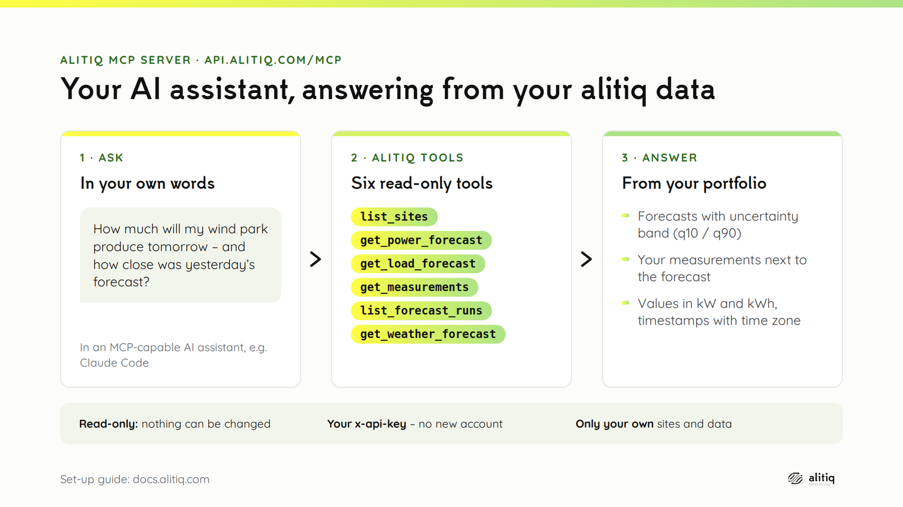

# Connect AI Assistants with the alitiq MCP Server 🤖

The alitiq MCP server lets AI assistants read your alitiq data directly: your sites, power and load forecasts, measurements and weather forecasts. Ask a question in your own words - *"How much will my wind park produce tomorrow, and how close was yesterday's forecast?"* - and the assistant fetches the answer from your portfolio.



---

## What Is MCP? 🧩

The [Model Context Protocol (MCP)](https://modelcontextprotocol.io) is an open standard that connects AI assistants to external data sources. An MCP server offers a set of **tools**; the assistant decides which tool to call to answer your question.

The alitiq MCP server runs at:

```
https://api.alitiq.com/mcp
```

It is part of the alitiq API and uses the same `x-api-key` for authentication. You don't need a new account or a separate key.

---

## Requirements ✅

- Your alitiq `x-api-key` (see [Getting Started](../index.md#how-to-get-access)).
- An MCP client that supports the **Streamable HTTP** transport and lets you set a **custom request header**.

---

## Setup 🔌

=== "Claude Code"

    ``` bash
    claude mcp add --transport http alitiq https://api.alitiq.com/mcp --header "x-api-key: <your-api-key>"
    ```

    Start a new Claude Code session afterwards and check the connection with `/mcp`.

=== "VS Code"

    Add the server to `.vscode/mcp.json` in your workspace. VS Code asks for the key on first use and stores it securely, so it never ends up in the file:

    ``` json
    {
      "inputs": [
        {
          "type": "promptString",
          "id": "alitiq-api-key",
          "description": "alitiq x-api-key",
          "password": true
        }
      ],
      "servers": {
        "alitiq": {
          "type": "http",
          "url": "https://api.alitiq.com/mcp",
          "headers": { "x-api-key": "${input:alitiq-api-key}" }
        }
      }
    }
    ```

=== "Cursor"

    Add the server to `~/.cursor/mcp.json`:

    ``` json
    {
      "mcpServers": {
        "alitiq": {
          "url": "https://api.alitiq.com/mcp",
          "headers": { "x-api-key": "<your-api-key>" }
        }
      }
    }
    ```

=== "Other clients"

    | **Setting**   | **Value**                    |
    |---------------|------------------------------|
    | URL           | `https://api.alitiq.com/mcp` |
    | Transport     | Streamable HTTP              |
    | Header        | `x-api-key: <your-api-key>`  |

    The server is stateless and answers with plain JSON, so no session handling is needed on the client side.

!!! warning "Keep your key out of shared files"
    An MCP configuration with your `x-api-key` in it grants access to your portfolio. Don't commit it to a repository or share it. Where your client supports it, use a secure input or an environment variable instead of the plain key.

---

## Available Tools 🛠️

All tools are **read-only**: an assistant can look at your data, but cannot add, change or delete anything.

| **Tool**               | **What it returns**                                                                                                     |
|------------------------|--------------------------------------------------------------------------------------------------------------------------|
| `list_sites`           | Your PV systems, wind parks and load locations: `location_id`, name, coordinates and installed capacity. Start here.     |
| `get_power_forecast`   | Power forecast of a PV system or wind park, with summary. The `optimized` model also returns the q10/q90 quantiles.      |
| `get_load_forecast`    | Load forecast of a load location, using the same model configuration as your regular forecast delivery.                 |
| `get_measurements`     | The measurements you sent to alitiq for a location, averaged to the requested interval.                                 |
| `list_forecast_runs`   | The most recent forecast runs (`dt_calc`) of a PV system or wind park - useful to compare a past forecast with measurements. |
| `get_weather_forecast` | Weather forecast for any coordinate, hourly (up to 240 hours ahead) or as daily means.                                  |

### Main Parameters

| **Parameter**         | **Tools**                                         | **Description**                                                                                     | **Default** |
|-----------------------|---------------------------------------------------|-----------------------------------------------------------------------------------------------------|-------------|
| `location_id`         | all except `list_sites`, `get_weather_forecast`   | Your own location id, as returned by `list_sites`.                                                  | -           |
| `asset_type`          | power forecast, measurements, forecast runs        | `solar`, `wind` or `load` (`load` for measurements only). Must match the location.                  | -           |
| `weather_model`       | power forecast, forecast runs, weather forecast    | Power: `optimized`, `icon_eu`, `icon_d2`, `ecmwf_ifs_eu`, ... Weather: `mos_mix`, `icon_eu`, ...     | `optimized` / `mos_mix` |
| `dt_calc`             | power and load forecast                            | Forecast run (UTC). Omit it for the latest run.                                                     | latest      |
| `start`, `end`        | measurements                                       | Period (UTC if no offset given), at most 31 days.                                                   | last 7 days |
| `interval_in_minutes` | forecasts, measurements                            | Resolution of the returned series, 15 to 1440 minutes.                                              | `60`        |
| `timezone`            | forecasts, measurements                            | Time zone of the returned timestamps, e.g. `Europe/Berlin`.                                         | `UTC`       |

You rarely need to set these yourself: the assistant reads the tool descriptions and picks the parameters from your question.

---

## How to Read the Results 📏

- **Units:** all power values are in **kW**, energy in **kWh** - also for load locations.
- **Timestamps** carry their UTC offset and mark the **end** of each interval (like `window_boundary=end` in the REST API).
- **Summary:** forecasts and measurements come with mean, minimum and maximum power and the energy. These are computed from the data in its original resolution, so a coarse `interval_in_minutes` doesn't distort them.
- **Weather model:** the result names the model that actually delivered the forecast. If an `optimized` forecast is not available, alitiq falls back to ICON, and the result says so.
- **Size limit:** a series has at most 500 time steps. For longer periods, the assistant asks for a larger `interval_in_minutes`.

---

## Example Questions 💬

- *"Which sites do I have at alitiq, and how much capacity is installed?"*
- *"Show me tomorrow's forecast for my wind park in Europe/Berlin time, hourly."*
- *"Compare yesterday's day-ahead forecast of my PV system with the measured values."*
- *"How much energy did my PV systems produce last week, according to the measurements?"*
- *"What is the weather forecast for my wind park's location for the next three days?"*

---

## Security and Limits 🔒

- **Your data only:** every tool call is checked against your `x-api-key`; an assistant can only see your own locations.
- **Read-only:** no tool can change your portfolio, measurements or forecasts.
- **Regular API requests:** each tool call is a normal request to the alitiq API and counts towards your usage like any other request.
- **Token rotation:** if you regenerate your key in the [Token Management Center](../knowledge/posts/token_management_and_2fa_in_api_gui.md), update your MCP configuration as well.

---

## Troubleshooting 🧰

| **Message**                                                    | **What to do**                                                                                       |
|----------------------------------------------------------------|------------------------------------------------------------------------------------------------------|
| `401 Unauthorized`                                             | The `x-api-key` header is missing, wrong or expired. Check your configuration and the key's expiry date. |
| `Unknown location_id ... Call list_sites for valid ids.`       | Use the `location_id` exactly as `list_sites` returns it.                                            |
| `location_id ... is not a 'load' location.`                    | The `asset_type` doesn't match the location. `list_sites` shows each location's type.                |
| `The result would contain ... time steps (limit 500).`         | Ask for a larger interval or a shorter period.                                                       |

Questions or feedback? Reach out to **[support@alitiq.com](mailto:support@alitiq.com)**.
